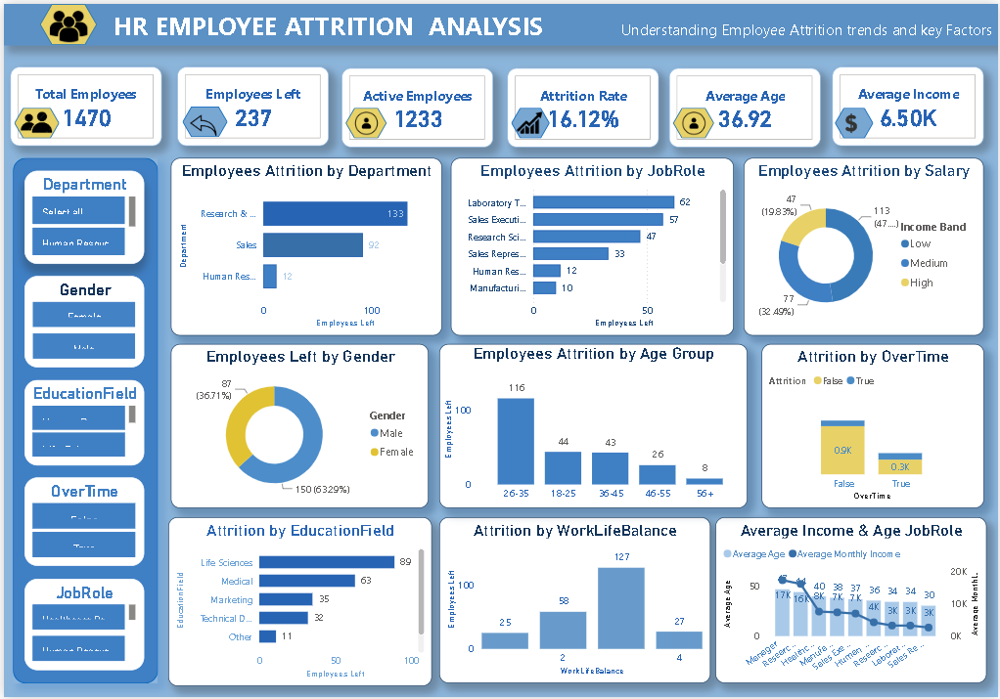
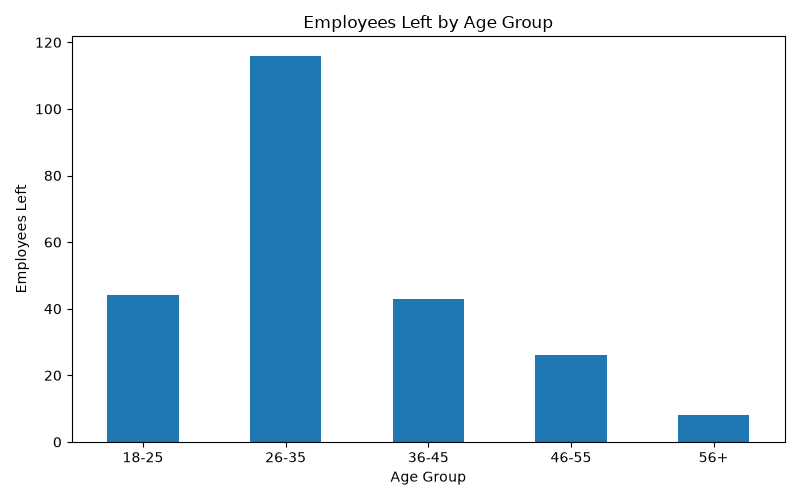
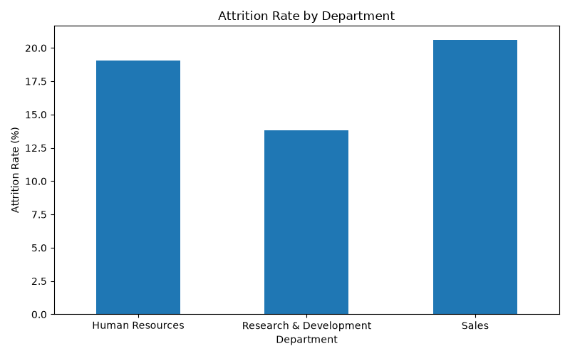
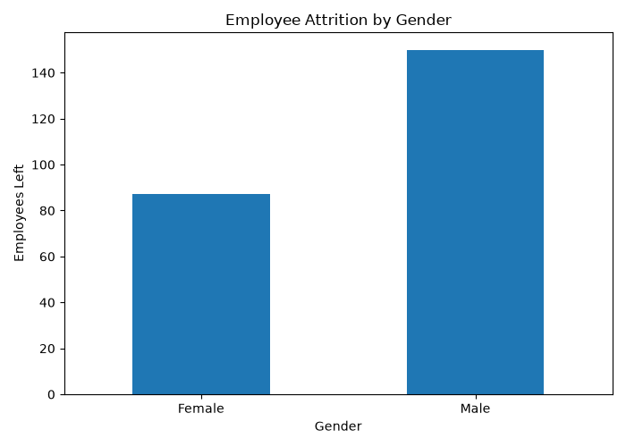
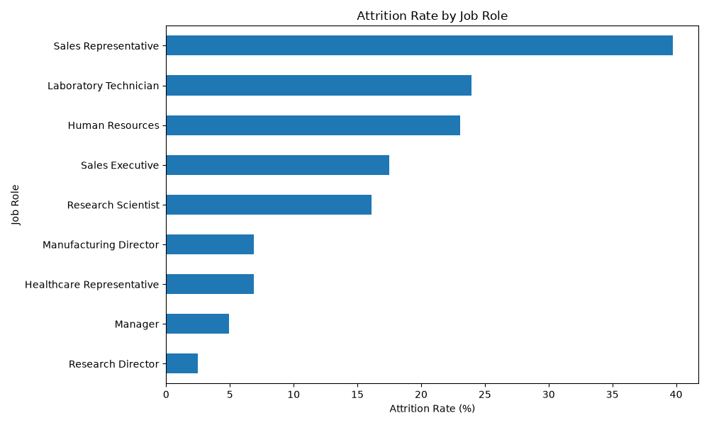
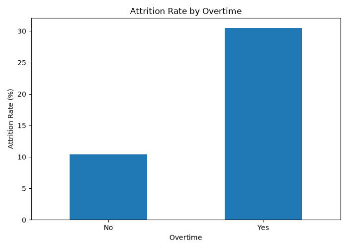

# People Pulse — HR Employee Attrition Insights

An end-to-end HR analytics portfolio project exploring employee attrition with **Python, MySQL, Excel, and Power BI**. The project includes a 1,470-record employee dataset, an Excel analysis workbook, SQL analysis queries, Python visualizations, a Power BI report, and supporting documentation.

> **Project scope:** This is a descriptive analytics project. It highlights workforce patterns and areas for further investigation; it does not establish why an employee leaves or prove causation.

## Repository contents

```text
people-pulse-hr-attrition-insights/
├── Dashboard/
│   └── dashboard.png
├── data/
│   └── hr_employee_attrition.csv
├── excel/
│   └── HR_Employee_Attrition_Analysis.xlsx
├── insights/
│   └── Business_Analysis.md
├── outputs/
│   ├── attrition_by_age_group.csv
│   ├── attrition_by_department.csv
│   ├── attrition_by_education_field.csv
│   ├── attrition_by_gender.csv
│   ├── attrition_by_income_band.csv
│   ├── attrition_by_job_role.csv
│   ├── attrition_by_overtime.csv
│   ├── attrition_by_work_life_balance.csv
│   └── kpi_summary.csv
├── powerbi/
│   ├── DAX_Measures.md
│   └── HR_Employee_Attrition.pbix
├── python/
│   ├── analysis.py
│   └── HR_Attrition_Results.csv
├── screenshots/
│   ├── dashboard.png
│   ├── age_attrition.png
│   ├── department_attrition.png
│   ├── gender_attrition.png
│   ├── jobrole_attrition.png
│   └── overtime_attrition.png
├── sql/
│   ├── create_database.sql
│   └── analysis_database.sql
├── requirements.txt
└── README.md
```

## Business problem

Employee turnover can create recruitment and onboarding costs, disrupt team productivity, and lead to loss of organizational knowledge. HR teams need to understand the scale of attrition and how employee exits differ across workforce segments.

This project explores questions such as:

- What are the total employee count, number of exits, and attrition rate?
- How does attrition vary by department and job role?
- How do exit patterns differ by age group, gender, education field, and income band?
- How does attrition compare between employees who work overtime and those who do not?
- How do employee exits vary across work-life-balance groups?

## Dataset and headline metrics

The included CSV contains **1,470 rows and 39 columns**. The Python analysis reads the `Clean_Data` sheet from the Excel workbook.

The following figures were reproduced by running `python/analysis.py` against the included workbook:

| Metric | Result |
|---|---:|
| Total employees | 1,470 |
| Employees who left | 237 |
| Employees who stayed | 1,233 |
| Attrition rate | 16.12% |
| Average age | 36.92 |
| Average monthly income | 6,502.93 |

These figures describe the supplied dataset and are not current workforce statistics.

## Tools and technologies

- **Python:** pandas, matplotlib, openpyxl
- **MySQL:** database creation, data validation, KPI queries, and segment analysis
- **Microsoft Excel:** workbook with raw data, cleaned data, pivot tables, analysis, and dashboard sheets
- **Power BI:** interactive report and DAX measures

## Run the Python analysis

### 1. Requirements

Install Python 3.10 or later, then open a terminal in the repository root.

### 2. Create and activate a virtual environment (recommended)

Windows PowerShell:

```powershell
python -m venv .venv
.venv\Scripts\Activate.ps1
```

macOS / Linux:

```bash
python3 -m venv .venv
source .venv/bin/activate
```

### 3. Install dependencies

```bash
python -m pip install -r requirements.txt
```

### 4. Run the analysis

```bash
python python/analysis.py
```

The script reads:

```text
excel/HR_Employee_Attrition_Analysis.xlsx
```

It prints dataset information and headline KPIs, creates charts in `python/charts/`, and exports `python/HR_Attrition_Results.csv`.

## Run the MySQL analysis

1. Install and start MySQL Server, then open MySQL Workbench.
2. Open and execute `sql/create_database.sql` to create the database and table.
3. Import `data/hr_employee_attrition.csv` into the `hr_employee_attrition` table using MySQL Workbench's **Table Data Import Wizard**. Map the CSV columns to the matching table columns and confirm that the header row is treated as column names.
4. Open and execute `sql/analysis_database.sql` to run the validation and analysis queries.

The CSV and SQL table use the same 39 snake_case column names. If you use a different MySQL import method, configure it to skip the CSV header and preserve the column order.

## Open the Power BI report

1. Open `powerbi/HR_Employee_Attrition.pbix` in Power BI Desktop.
2. If Power BI prompts for a data source, reconnect it to the included dataset or workbook as appropriate for the report's existing model.
3. Refresh the data and check that visuals and slicers load correctly.
4. Refer to `powerbi/DAX_Measures.md` for documented measures and `insights/Business_Analysis.md` for the business interpretation.

The PBIX file is included in the repository. Its internal model, refresh configuration, and visual interactions have not been independently validated in this review, so refresh it in Power BI Desktop before presenting it.

## Dashboard and analysis previews

Dashboard preview:



Additional Python analysis charts:

| Analysis | Preview |
|---|---|
| Attrition by age group |  |
| Attrition by department |  |
| Attrition by gender |  |
| Attrition by job role |  |
| Attrition by overtime |  |

## Documentation

- [`insights/Business_Analysis.md`](insights/Business_Analysis.md) — business problem, KPIs, analysis areas, recommendations, and limitations.
- [`powerbi/DAX_Measures.md`](powerbi/DAX_Measures.md) — DAX measures and suggested visual mappings.
- [`sql/analysis_database.sql`](sql/analysis_database.sql) — SQL analysis queries.
- [`requirements.txt`](requirements.txt) — Python dependencies.

## Important interpretation notes

- Attrition rate is calculated as employees with `Attrition = "Yes"` divided by the total employee count.
- Compare both counts and rates. A segment with more exits may simply have a larger employee population.
- Segment patterns are descriptive associations, not evidence of causation.
- Validate data definitions and the Power BI model after refreshing the report.
- Do not make decisions about individual employees from group-level analysis alone.

## Before publishing to GitHub

- [ ] Open the PBIX in Power BI Desktop, refresh it, and verify the visuals and slicers.
- [ ] Import the CSV into MySQL and run the SQL analysis script.
- [ ] Run the Python script from the repository root.
- [ ] Confirm that the dashboard screenshots are current and readable.
- [ ] Check that no private employee information, credentials, or local machine paths are committed.

## Suggested repository metadata

**Repository name:** `people-pulse-hr-attrition-insights`

**Description:** End-to-end HR Employee Attrition Analysis using Python, MySQL, Excel, and Power BI to explore workforce turnover, employee retention, and HR performance indicators.

---

Created as a data analytics portfolio project.
